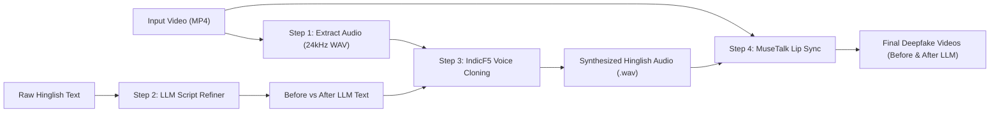

# Hinglish DeepFake Generation & Ablation Study

An end-to-end multimodal deepfake generation pipeline combining **LLM-guided Hinglish script refinement**, fine-tuned **IndicF5-Hinglish Flow Matching voice cloning**, and real-time **MuseTalk lip synchronization**.

---

## 📌 Project Overview & Architecture

This repository enables fine-grained cross-lingual deepfake generation and ablation studies comparing speech clarity and lip sync between:
* **Before-LLM (Baseline):** Raw colloquial Hinglish input.
* **After-LLM (Refined):** Code-switched script formatted into Devanagari (Hindi) + Latin (English) with conversational pause punctuation.



---

## 📂 Repository Structure

```
DeepFake_Generation_Model/
├── data/
│   ├── raw_videos/           # Source video clips (1080p MP4)
│   ├── reference_data/       # Extracted 24kHz reference audio
│   ├── generated_audio/      # Synthesized Before/After LLM speech (WAV)
│   ├── generated_videos/     # Final deepfake lip-synced videos (MP4)
│   └── metadata.csv          # Comprehensive experiment registry & logs
├── indicf5_finetune_repo/    # Fine-tuned IndicF5-Hinglish TTS model & tokenizer
├── models/
│   ├── MuseTalk/             # Real-time latent lip synchronization model
│   └── indicf5/              # Vocabulary and tokenization assets
├── src/
│   ├── data/                 # Audio extraction utilities
│   ├── features/             # LLM Hinglish refinement (Gemini / OpenAI)
│   └── models/               # Model wrappers for IndicF5 & MuseTalk
├── pipeline.py               # End-to-end pipeline execution CLI
├── requirements.txt          # Python dependencies
└── .env.example              # Template for API keys
```

---

## 🚀 Getting Started (Team Setup)

### 1. Prerequisites
* **OS:** Linux (Ubuntu 20.04/22.04 recommended) or WSL2 on Windows
* **GPU:** NVIDIA GPU with at least 12GB VRAM (CUDA 12.x supported)
* **FFmpeg:** System-wide `ffmpeg` installed (`sudo apt install ffmpeg`)

### 2. Clone the Repository
```bash
git clone https://github.com/RiwanBhati/DeepFake_Generation_Model.git
cd DeepFake_Generation_Model
```

### 3. Create Virtual Environment & Install Dependencies
```bash
python3 -m venv .venv
source .venv/bin/activate

# Install dependencies
pip install --upgrade pip
pip install -r requirements.txt

# Install IndicF5 package in editable mode
pip install -e indicf5_finetune_repo
```

### 4. Download MuseTalk Model Weights
Run the official weights download script (downloads UNet, SD-VAE, Whisper, and DWPose weights into `models/MuseTalk/models/`):
```bash
cd models/MuseTalk
bash download_weights.sh
cd ../..
```

*(Note: The weights directory is ignored in Git due to file size limits).*

### 5. (Optional) Configure LLM API Keys
Copy `.env.example` to `.env` and set your API key if you want automated text refinement:
```bash
cp .env.example .env
# Open .env and add GEMINI_API_KEY or GROQ_API_KEY
```

---

## 🎬 Running the Pipeline

Run the end-to-end pipeline using `pipeline.py`:

```bash
python pipeline.py \
    --video data/raw_videos/new_video.mp4 \
    --ref_text "I think हम France के साथ ज़्यादा comfortable हैं क्योंकि वो हमें lecture नहीं देता, you know, और ऐसे behave नहीं करता कि मैं teacher हूँ और भारत line में खड़े हो जाओ। They're not like that." \
    --target_text "I think we prefer France because वहाँ का माहौल थोड़ा अलग है, you know, वो हर बात पर lecture नहीं देते, they are just more easygoing." \
    --sample_id sample_02 \
    --bbox_shift 0
```

### Key Arguments:
* `--video`: Path to input 10-second MP4 video.
* `--ref_text`: Reference transcript of what the speaker says in the video.
* `--target_text`: The new Hinglish sentence to synthesize.
* `--refined_text`: (Optional) Explicit English+Devanagari text if you want to bypass LLM.
* `--sample_id`: Identifier for outputs (e.g. `sample_01`, `sample_02`).
* `--bbox_shift`: MuseTalk bounding box shift (`0` for calibrated sharp lip sync).
* `--skip_video`: Only synthesize audio, skipping video generation.

All outputs are automatically registered in [`data/metadata.csv`](data/metadata.csv).
